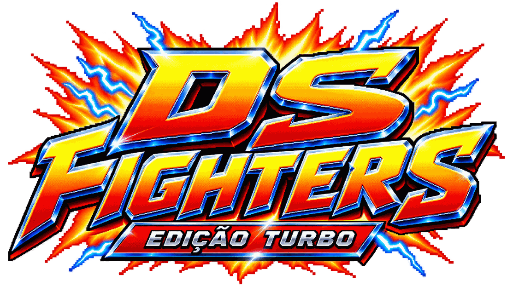

# DS FIGHTERS — Edição Turbo

Jogo de luta 2D lateral no navegador, com visual arcade retrô do começo dos anos 90. Arte, sons e código são originais (inspirado no gênero, sem copiar Street Fighter ou outro jogo). Menus, seleção, HUD, mascotes, resgate e salas são feitos em HTML/CSS; o Canvas fica só para a arena.



**17 lutadores · 30 arenas · 5 habilidades animadas por lutador · CPU com 4 dificuldades · online grátis até 4 jogadores (1 × 1 e 2 × 2)**

## Novidades da Edição Turbo

- **5 lutadores novos**: Yumi (Kotlin), RootKit (hacker do Kali), Mestre Java, Cromo (mercenário com esquiva) e BHM (raio + sombra).
- **DU e Felipinho Maprim redesenhados**: DU careca, de óculos e barba grisalha; Maprim de boné e meia barba.
- **Combos muito mais fluidos**: buffer de entrada (inclusive no hitstop), cadeias automáticas e cancelamentos em habilidades.
- **Efeitos de status por lutador**: explosão, dano contínuo, stun, cegueira (tela embaçada), elétrico (teclas se mexem sozinhas), gelo (lentidão), vulnerável e sem poderes.
- **Balanceamento** feito com torneios automáticos CPU × CPU; o trio secreto continua acima, IALES no topo.
- **CPU com 4 níveis reais**: Fácil, Normal, Difícil e Pesadelo.
- **120+ FPS** com imagem interpolada (simulação fixa em 60 Hz).
- **Nova logo** estilo arcade e **4 arenas novas** com mecânicas próprias.
- **Online P2P sem servidor**, 2 × 2 com 4 jogadores, troca e assist, chat, link de convite e ping.


## Como rodar

Sirva a pasta (os navegadores bloqueiam `fetch` em `file://`):

```bash
python3 -m http.server 8080
# abra http://localhost:8080
```

O online já funciona assim, sem servidor próprio (P2P). O servidor dedicado é **opcional** (veja [HOSPEDAGEM.md](HOSPEDAGEM.md)):

```bash
cd online-server && npm install && npm start   # ws://localhost:8787 (opcional)
```

## Jogar online (grátis)

1. Abra o jogo pelo endereço publicado e vá em **Online**. A conexão padrão é **P2P** (não precisa de servidor).
2. Escolha o modo (**1 × 1**, **2 × 2 — duplas, 2 jogadores** ou **2 × 2 — 4 jogadores**) e clique em **CRIAR SALA**.
3. Mande o **código de 6 letras** ou o **link de convite** para os amigos; eles digitam o código e clicam em **ENTRAR NA SALA** (pelo link, o código já vem preenchido).
4. No lobby, cada um escolhe lutador (e equipe, no 2 × 2), a arena é definida pelo anfitrião e a luta começa quando **todos marcam PRONTO**.

Quem cria a sala é o anfitrião: o navegador dele simula a luta, então ele não pode fechar a aba. Quem cair tem 30 s para voltar. Se alguma rede bloquear a conexão direta (redes de empresa, alguns 4G), use o servidor dedicado opcional.

## Publicar para todo mundo jogar

O jogo é só arquivos estáticos, então qualquer hospedagem estática gratuita serve:

- **Vercel**: importe o repositório, preset **Other**, sem comando de build, diretório = raiz. O `vercel.json` e o `.vercelignore` já estão prontos.
- **Netlify / Cloudflare Pages**: mesmo esquema.
- **GitHub Pages**: *Settings → Pages → `main` / `(root)`* → `https://thales971.github.io/Ds-fighters/`.

Passo a passo completo, servidor dedicado (Render, Fly.io, VPS, Docker) e checklist em [HOSPEDAGEM.md](HOSPEDAGEM.md).

## Modos

| Modo | O que é |
|---|---|
| **Arcade** | Escada de 7 lutas contra a CPU na dificuldade escolhida (as duas últimas sobem um nível) e chefe final (IALES, se liberado). Perdeu? Continue. |
| **Versus** | 1 × 1 contra a CPU ou contra outro jogador no mesmo PC. Na seleção, o Jogador 2 aperta `1` para entrar. |
| **CPU (4 níveis)** | **Fácil** (reage devagar, quase não defende), **Normal** (defende e faz combos curtos), **Difícil** (pune erros, antiaéreo, combos longos) e **Pesadelo** (leitura quase perfeita). Em teste automático o Pesadelo vence o Fácil 15 × 1. |
| **2 × 2 Equipes** | Cada lado escolhe 2 lutadores. **Troca** = tecla de troca; **Assist** = baixo + troca (o parceiro entra, solta a H1 e volta). O parceiro no banco recupera vida. Perde quem ficar sem os dois. |
| **Treino** | Boneco parado/defendendo/pulando/CPU, medidores infinitos opcionais, sem tempo. |
| **Online** | Salas com código e **link de convite**, chat, ping, placar da sala. Modos **1 × 1**, **2 × 2 com 2 jogadores** e **2 × 2 com 4 jogadores** (cada um controla 1 lutador; quem está na reserva entra com TROCA ou chama ASSIST com SOCO). Conexão **P2P grátis** ou servidor dedicado. |

## Controles

| Ação | Jogador 1 | Jogador 2 | Controle |
|---|---|---|---|
| Mover / pular / agachar | Setas | `J` `L` `I` `K` | Analógico / D-pad |
| Soco · Chute | `A` · `S` | `1` · `2` | □ · ✕ |
| H1 · H2 (simples, recarga) | `D` · `F` | `3` · `4` | ○ · △ |
| H3 · H4 (carga A / B) | `Q` · `W` | `5` · `6` | L1 · R1 |
| ULTIMATE | `E` | `7` | R2 |
| Troca (2 × 2) | `R` | `8` | L2 |
| Pausa | `Esc` / `P` | | Start |

A tecla de cada habilidade aparece **embaixo do ícone** na HUD. Defender: segure para trás (agachado defende golpes baixos). Dash: toque duas vezes. Agarrão: perto do rival, frente/trás + soco. Combos: soco → soco → chute encadeiam sozinhos; qualquer golpe que acertar pode ser cancelado em habilidade, e habilidades simples podem ser canceladas em carga/ultimate. As entradas ficam guardadas por ~10 quadros (inclusive durante o hitstop), então dá para apertar o próximo golpe antes do atual terminar. Há controles de toque em telas sensíveis ao toque e a opção "movimento reduzido" nas Opções.

## Sistemas de luta

Combos fluidos com buffer de entrada, cadeias automáticas (soco → soco → chute), cancelamento de golpe em habilidade e de habilidade simples em carga/ultimate, contador de hits e dano reduzido progressivamente, hitstop, knockback por peso, golpes altos/baixos, contra-ataque, barra de tontura, dano vermelho recuperável, câmera com zoom e tremor, cut-in de ultimate, KO em câmera lenta e "PERFEITO".

**Efeitos de status** (cada lutador tem uma assinatura — veja a tabela abaixo):

| Efeito | O que faz |
|---|---|
| Explosão | Dano extra em área no acerto |
| Dano contínuo | Queimadura, veneno ou sangramento tiram vida com o tempo |
| Stun | Enche a barra de tontura; cheia = rival TONTO |
| **Cegueira** | A **tela do rival fica embaçada** (no online e contra a CPU) |
| **Elétrico** | **As teclas do rival começam a se mexer sozinhas** (direções trocadas e golpes fantasmas) e os ícones da HUD tremem |
| **Gelo** | Lentidão: anda, pula e ataca mais devagar |
| Vulnerável | Recebe +20 % de dano |
| Sem poderes | Habilidades bloqueadas por alguns segundos |

**120+ FPS**: a simulação roda em passo fixo de 60 Hz (justo e igual para todos, inclusive online) e a imagem é **interpolada** na taxa do monitor (120/144/240 Hz). Em *Opções*: limite de FPS, movimento suavizado e contador de FPS.

Cada lutador tem **5 habilidades animadas**: 2 simples (recarga), 2 de carga (barras A e B) e 1 ultimate. As sprite sheets ficam em `assets/abilities/<id>.png` (4 quadros × 5 linhas de 128 px). Os dados ficam em `js/data/powers.js` e `js/data/powers-turbo.js`.

## Lutadores

17 lutadores (o Senpai foi removido). **DU, IALES e Felipinho Maprim** são secretos: resgate o código **`Batata`** em *Resgatar código* para liberar os três juntos (fica salvo no navegador). Eles são propositalmente mais fortes; **IALES é o mais apelão**.

| Lutador | Assinatura | Estilo |
|---|---|---|
| **IALES** (secreto) | AUTO AIM + ROUBO | *Todos* os ataques têm auto aim, IAs atrás dele ao conjurar, acúmulo estilo All For One. **Ctrl+C dos Poderes** acerta sempre e rouba as 5 habilidades do rival por 10 s. Dragão de Fogo Rust. Ultimate **All For One: Merge Total**. |
| **DU** (secreto) | EXPLOSÃO + FÚRIA | Careca, óculos e barba grisalha. Machado de magma, PHP, Fúria do Guerreiro; com pouca vida causa +25 % de dano. |
| **Felipinho Maprim** (secreto) | ÁGUA | Boné e meia barba. Água + React: deixa lento e rouba vida. |
| **Yumi** (Kotlin) | RAPIDEZ + GELO | Baixinha, cabelo claro e óculos; a mais rápida do jogo. Ataques violeta/laranja/azul do Kotlin; corrotinas teleguiadas e cristais Null-Safe que congelam. |
| **RootKit** (hacker) | HACK DE STATUS | Kali Linux, Nmap, phishing, DDoS e `sudo rm -rf`: cegueira, controles eletrizados, vulnerável e sem poderes. |
| **Mestre Java** | TANQUE + EXPLOSÃO | Mestre do back-end de jaqueta: armadura da JVM, Garbage Collector que puxa, StackOverflowError que explode e Meteoro de Beans. |
| **Cromo** (mercenário) | ESQUIVA | Implantes cromados: modo de tempo lento com rastro, 18 % de chance de desviar sozinho, cortes que sangram. |
| **BHM** | RAIO + SOMBRA | Cabelo militar, moletom verde, calça baggy e tênis. Raios elétricos e golpes de sombra: eletriza e cega. |
| Stack Overflow | RAPIDEZ | Veloz; queima energia do rival. |
| Git Master | CEGUEIRA | Sombras embaçam a tela do rival. |
| Bug Hunter | DANO CONTÍNUO | Todo acerto de habilidade envenena. |
| Front Dev | ELÉTRICO | Neon eletriza os controles do rival. |
| Back Dev | STUN | Barra de tontura enche 50 % mais rápido. |
| DevOps | EXPLOSÃO | Explosões extras. |
| QA Tester | CORROSÃO | Ácido: vulnerável e envenenado. |
| Scrum Master | GELO / LENTIDÃO | Habilidades deixam lento. |
| Fullstack | COMBOS | Cadeias com 2 golpes a mais. |

**Balanceamento**: os atributos e kits foram ajustados com torneios automáticos CPU × CPU (todos contra todos, dos dois lados — `tools/ai_levels.py` e o script de torneio). Os lutadores comuns ficam numa faixa próxima entre si; o trio secreto fica acima de propósito.

## Arenas (30)

10 cenários animados originais, 10 do pacote retrô, 6 de tecnologia (**Floresta Spring Boot**, Colmeia JavaScript, Porto dos Containers, Ártico do Kernel, Fundição Rust, Pântano Python) e 4 da Edição Turbo:

| Arena | Mecânica |
|---|---|
| **Ilha Kotlin** | MARÉ ALTA: ondas empurram todo mundo para um lado |
| **Covil do Kali** | INVASÃO: um lutador é hackeado e fica com os controles eletrizados |
| **Torrefação JVM** | GARBAGE COLLECTOR: apaga projéteis e zonas e puxa todos ao centro |
| **Cidade Cromada** | DRONES: disparos do céu miram um lutador |

Todas as arenas têm **mecânica exclusiva** (lava, esteira, glitch que troca lugares, git revert, holofote, gelo escorregadio, enxame de abelhas, mel que gruda, containers que caem, serpente, gongo, baixa gravidade…) e **clima aleatório** com efeito real:

| Clima | Efeito |
|---|---|
| Chuva | Água e raio +15 %, fogo −15 %, chão escorrega |
| Ventania | Rajadas empurram lutadores e projéteis |
| Tempestade | Chuva + vento + raios que caem com aviso; raio +25 % |
| Nevasca | Movimento 8 % mais lento; gelo +20 % |

Pássaros, abelhas, borboletas, morcegos e peixes aparecem onde fazem sentido. **Power-ups** caem durante a luta (Ataque, Defesa, Velocidade e Energia), com tempo visível na HUD.

## Mascotes

Em *Mascotes*, cada jogador equipa um companheiro que aparece na arena e dá bônus real (salvo no perfil): Pinguim do Linux (+12 % defesa e regeneração), Baleia Container (escudo), Caranguejo Seguro, Cobra Script, Elefante Legado, Gopher Concorrente, Espírito da Primavera e Polvo do Commit.

## Música: seus rocks pesados

A cada batalha uma faixa é sorteada. Para usar as suas:

1. Envie os arquivos (`.mp3` ou `.ogg`) para `assets/music/rock/`.
2. Liste-os em `assets/music/playlist.json`:

```json
{
  "tracks": [
    { "title": "Minha Faixa 1", "file": "assets/music/rock/faixa1.mp3" },
    { "title": "Minha Faixa 2", "file": "assets/music/rock/faixa2.mp3" }
  ]
}
```

Enquanto `tracks` estiver vazio, tocam as faixas originais de `fallback`. Se uma faixa listada não existir, o jogo pula para outra. Volumes separados (geral, música, efeitos, narrador) e mudo ficam em *Opções*. O áudio só começa após o primeiro clique/tecla (regra dos navegadores).

## Estrutura

```
js/core/profile.js      perfil, desbloqueio por código, mascotes, opções
js/data/                fighters, powers (5 habilidades), stages, pets
js/engine/              game (rounds, 2x2, câmera, rede), fighter (combate),
                        projectile, fx, weather, mechanics, stage, ai, audio, input
js/ui/                  hud.js (HUD em HTML), ui.js (telas e navegação)
js/net/room-core.js     núcleo das salas (mesmo código no servidor e no anfitrião P2P)
js/net/online.js        cliente online (P2P via PeerJS/WebRTC ou WebSocket)
js/vendor/peerjs.min.js PeerJS 1.5.4 (MIT)
online-server/          servidor dedicado opcional (Node + ws) e testes
assets/abilities        sprite sheets das habilidades
assets/art-pack         pacote retrô (impactos, fogo, água, raio, caos, símbolos de IAs, pássaros, chão, 10 fundos)
tools/                  scripts de build de assets e testes automáticos
```

Testes:

- `python3 tools/smoke.py` — todas as 30 arenas, 17 lutadores e habilidades no Chromium.
- `python3 tools/abilities_check.py` — as 5 habilidades dos lutadores novos e os efeitos de tela (cegueira/choque).
- `python3 tools/ai_levels.py` — confirma que os 4 níveis de CPU são diferentes.
- `python3 tools/online_e2e.py ws 2`, `ws 4`, `p2p 2`, `p2p 4` — partidas online reais entre 2 e 4 navegadores (P2P precisa de internet).
- `cd online-server && npm test` — 30 verificações do servidor (salas, isolamento, 4 jogadores, reconexão, limites).

Fonte: Press Start 2P (SIL Open Font License).

## Cenários animados originais (técnico)

São os 10 fundos animados do dono, em `assets/stages/`. Cada PNG é uma folha de 6 colunas por 4 linhas, 24 frames de 960×540, a 10 fps. O jogo só blita o frame da vez. O chão em perspectiva foi pintado por cima da arte original, e silhuetas escuras de gente que apareciam no piso foram apagadas.

1. Centro de Dados
2. Chuva de Código
3. Laboratório 95
4. Neon City.exe
5. Fight.exe
6. Fábrica de Bugs
7. Placa-Mãe
8. Startup 3am
9. Deploy nas Nuvens
10. Arena Git

Os GIFs de origem estão em `assets/stages/source/`. Para reprocessar:

```bash
node tools/process-stages.mjs
```

## Sprites dos lutadores

As folhas ficam em `assets/sprites/`. Cada frame tem 320×260. A ordem das linhas está em `assets/sprites/layout.js`: idle, andar, pulo, agachar, soco, chute, soco agachado, chute agachado, soco no ar, chute no ar, especial, hit, bloqueio, KO e vitória. O jogo alinha o pé na linha `baseline`.
