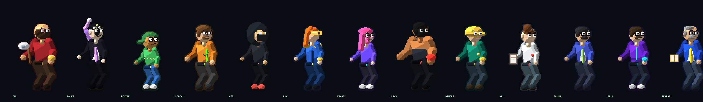

# DS FIGHTERS — Torneio dos Desenvolvedores

Jogo de luta 2D no navegador, em HTML5 Canvas e JavaScript puro. Os lutadores usam **sprite sheets de pixel art originais** (nada copiado de Street Fighter ou de outro jogo).



## Como rodar

Abra o `index.html` no navegador. Se o navegador bloquear scripts locais, sirva a pasta:

```bash
python3 -m http.server 8080
```

Aí acesse `http://127.0.0.1:8080`.

Atalhos úteis:

- `index.html#select` abre a seleção de lutadores
- `index.html#demo?stage=5&p1=0&p2=7` começa uma luta de demonstração (os dois são a CPU). `stage` vai de 0 a 5.

## Modos

- **Arcade (vs CPU)** — melhor de 3 rounds. A CPU fica mais esperta a cada round.
- **Versus** — dois jogadores no mesmo teclado, ou dois controles.

`Esc` no meio da luta volta ao menu.

## Controles

| Ação | Teclado P1 | Teclado P2 | Controle (padrão, PS4) |
|---|---|---|---|
| Andar | ← → | J L | Direcional ou analógico esquerdo |
| Pular | ↑ | I | Cima |
| Agachar / guarda baixa | ↓ | K | Baixo |
| Guarda em pé | segure para trás | segure para trás | segure para trás |
| Soco | A | 1 | Quadrado ou L1 |
| Chute | S | 2 | X ou R1 |
| Especial | D | 3 | Círculo ou L2 |
| Super | F | 4 | Triângulo ou R2 |
| Confirmar | Enter | Enter | X ou Options |

No celular aparecem botões de toque.

### Comandos de luta

- **Guarda em pé** (para trás) segura golpe médio e golpe de pulo. A rasteira passa.
- **Guarda baixa** (para baixo) segura golpe médio e rasteira. O pulo passa.
- **Agachado + chute** é golpe baixo. **Pulo + ataque** é golpe alto.
- **↓ ↘ → + soco** (ou o botão D / 3) solta o **simples 1**. Sempre disponível.
- **↓ ↙ ← + chute** solta o **simples 2**. Sempre disponível.
- **↓ ↘ → + chute** solta a **carga 1** quando a barra C1 está cheia.
- **↓ ↙ ← + soco** solta a **carga 2** quando a barra C2 está cheia.
- **↓ ↘ → ↓ ↘ → + soco** (ou o botão F / 4) solta o **ultimate** quando a barra ULT está cheia.
- **Toque duplo para frente** corre. Toque duplo para trás recua.
- Soco que acerta pode ser cancelado no chute, e golpe acertado pode ser cancelado num poder.

Cada lutador tem **5 poderes**: 2 simples, 2 de carga e 1 ultimate. C1, C2 e ULT enchem ao acertar e ao apanhar (apanhar enche mais a C2). A barra pisca em branco quando o golpe daquela carga está pronto. ULT pisca rosa e mostra a palavra ULT. Os medidores passam de um round para o outro e zeram numa luta nova.

A barra de vida mostra o dano fantasma em amarelo. Quem ganhar 2 rounds vence a luta. O timer começa em 99.

## Lutadores

Cada um tem um elemento. O efeito visual vem do sheet desse elemento.

| Lutador | Elemento | Simples | Carga | Ultimate |
|---|---|---|---|---|
| **DU** | Fogo | Lâmina de Brasa, Chute de Forja | Meteoro, Aura de Fúria | Inferno do Código |
| **IALES** | Gelo | Estilhaço, Toque Frio | Orbe Glacial, Armadura de Gelo | Zero Absoluto |
| **FELIPINHO** | Raio | Faísca, Drift | Trovoada, Nitro | Modo Deus |
| **STACK OVERFLOW** | Vento | Resposta Certa, Copy Rápido | Tempestade de Abas, Aceito | Copy-Paste |
| **GIT MASTER** | Sombra | Shuriken de Commit, Git Dash | Branch Sombria, Stash | Rebase Interativo |
| **BUG HUNTER** | Veneno | Relatório, Caça | Infestação, Antídoto | Hotfix |
| **FRONT DEV** | Neon | Caixa de Layout, Flex Dash | Gradiente, Keyframe | CSS Ultra |
| **BACK DEV** | Terra | Erro 500, Query Pesada | Muralha, Transação | DDoS de Socos |
| **DEVOPS** | Metal | Pipeline, Rollback | Cluster, Container | Deploy Contínuo |
| **QA TESTER** | Ácido | Caso de Teste, Assert | Regressão, Cobertura | Suíte Completa |
| **SCRUM MASTER** | Tempo | Post-it, Daily | Sprint, Bloqueio | Planning Poker |
| **FULLSTACK** | Arcano | Commit Duplo, Merge | Stack Trace, Monorepo | Monolito Perfeito |
| **SENPAI DO SENAI** | Espírito | Apostila, Correção | Lição, Chamada | Prova Final |

Os dados ficam em `js/data/powers.js`. Para trocar o desenho de um golpe, aponte o elemento para outro arquivo em `assets/fx/layout.js` ou substitua o PNG.

## Efeitos (spritesheet)

O canvas só copia retângulos desses PNG. Não há desenho de bola, raio ou chama no código do jogo.

Arquivo: `assets/fx/<elemento>.png`

| | |
|---|---|
| Frame | 96 × 96 px |
| Grade | 8 colunas × 5 linhas |
| Fundo | transparente |
| Linha 0 | `projectile` — 8 frames, o tiro em loop |
| Linha 1 | `impact` — 6 frames, a explosão no acerto |
| Linha 2 | `aura` — 8 frames, o anel em volta do lutador |
| Linha 3 | `ultimate` — 8 frames, o corte cinematográfico |
| Linha 4 | `flash` — 4 frames, o clarão da tela |

O mapa de nomes fica em `assets/fx/layout.js` (`FX_LAYOUT.clips` e `FX_LAYOUT.sheets`). Um poder usa o sheet do elemento do lutador e o clipe pelo nome (`projectile`, `impact`, `aura`, `ultimate`, `flash`). Dá para substituir o PNG inteiro, desde que a grade continue 8×5 de 96×96. Para gerar de novo os placeholders:

```bash
node tools/gen-fx.mjs
```

## Cenários

São os 10 fundos animados do dono, em `assets/stages/`. Cada PNG é uma folha de 6 colunas por 4 linhas, 24 frames de 960×540, a 10 fps. O jogo só blita o frame da vez. O chão em perspectiva foi pintado por cima da arte original, e silhuetas escuras de gente que apareciam no piso foram apagadas.

1. Centro de Dados
2. Chuva de Código
3. Laboratório 95
4. Neon City.exe
5. Fight.exe
6. Fábrica de Bugs
7. Placa-Mãe
8. Startup 3am
9. Deploy nas Nuvens
10. Arena Git

Os GIFs de origem estão em `assets/stages/source/`. Para reprocessar:

```bash
node tools/process-stages.mjs
```

## Sprites dos lutadores

As folhas ficam em `assets/sprites/`. Cada frame tem 320×260. A ordem das linhas está em `assets/sprites/layout.js`: idle, andar, pulo, agachar, soco, chute, soco agachado, chute agachado, soco no ar, chute no ar, especial, hit, bloqueio, KO e vitória. O jogo alinha o pé na linha `baseline`.
