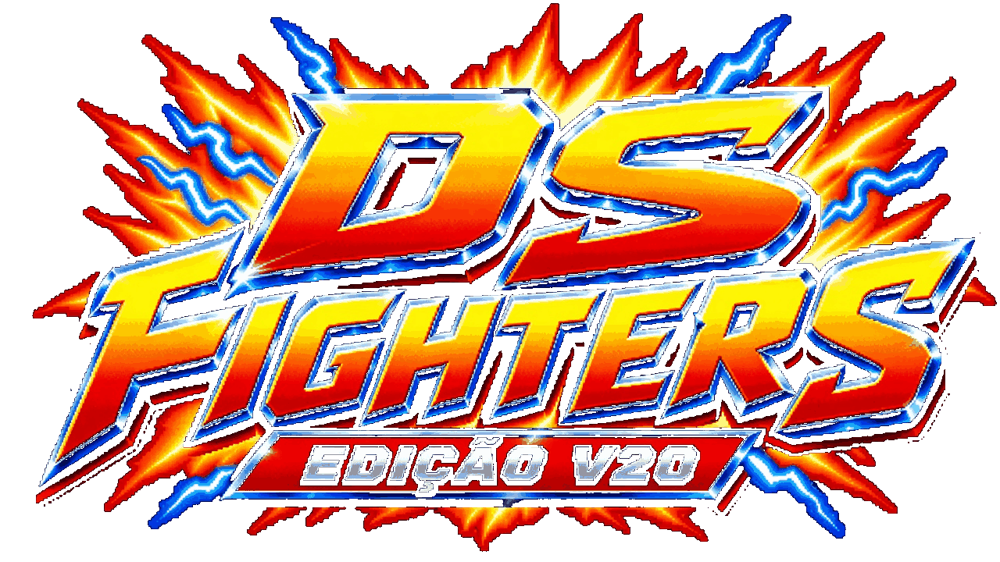

# DS FIGHTERS — Edição V19

Jogo de luta 2D lateral no navegador, com visual arcade retrô do começo dos anos 90. Arte, efeitos sonoros e código próprios; músicas comerciais de batalha fornecidas pelo proprietário, identificadas em [FAIXAS.md](assets/music/FAIXAS.md). Menus, seleção, HUD, mascotes, resgate e salas são feitos em HTML/CSS; o Canvas fica só para a arena.



**40 lutadores · 46 arenas · 5+ habilidades por lutador (IALES tem 10) · CPU com 4 dificuldades · online até 4 jogadores · modo treino com dojo próprio · modo personalizado · 38 músicas**

## Novidades da V19

### Novos lutadores
- **John the Vibe Coder** (power 1.36) — o Herdeiro do Fuzil, discípulo do Dev Veterano. Inimigo do Lobão. Socos vibracionais auto-aim com choque, sangramento, queimadura, paralisia e trava de poderes.
- **Nimbo** (power 1.38) — o Portador Rachado, discípulo de Thales. Cópia fraca da Colheita que rouba poderes ao custo do próprio corpo, mas aprendeu a devolver (aura de cura).
- **Odette** (power 1.26) — a Elegância em Pessoa. Bolsa de mão que voa, escarpin que rasga e desfile de golpes.
- **Engenheira de Prompt** (power 1.24) — a Arquiteta de Instruções. Token bomba, janela de contexto, alucinação e prompt supremo.
- **Hana** (power 1.24) — a Jardineira de Código Vivo (visual reformulado). Serra de pétalas, sementes venenosas, puxão de vinhas e árvore sakura que cura.
- **Cyber-Psicopata** (power 1.48) — 96% máquina. Tank de pressão com foguetes, chute foguete e ciberneurose.
- **Grika** (power 1.30) — a Sonhadora Sombria (design reformulado). Trevas violeta, garras oníricas e singularidade.
- **Guarda Digital** (power 1.22) — a Sentinela do Perímetro. Firewall, blitz, campo de detenção e lockdown total.

### Rebalanceamento V18
- **+50% de vida** para todos os lutadores
- **Ultimate mais lenta** para carregar (ganho ×0.7)
- **Cromo VX (merc)**: 20% esquiva base + power 1.30 + hp 132
- **Lobão**: ult com regeneração + dmg ×1.6 + power 1.40
- **Dev Senior**: ult dura 420 frames + cura + regen + power 1.46
- **BHM**: todas as habilidades melhoradas + auto-aim + power 1.32
- **Felipinho**: power 1.44 + hp 142 + meterRate 1.55
- **Du**: power 1.38 + hp 138 + kit melhorado

### Iales com 10 habilidades
O Iales agora tem **10 habilidades** (era 7): 5 básicas + 2 roubos extras + vírus de corrupção (freeze+poison+chill+bleed) + Format C: /IA (paralisia+vertigem+glitch+dreno) + All For One: Ação Final (meteoro que cresce com acúmulo).

### Modo Treino turbinado
- **Dojo de Treino** novo como mapa padrão
- **Todos os personagens desbloqueados** no modo treino
- Boneco: Parado / Defende / Pula / Anda / Agacha / Aleatório / CPU
- **Cura automática** (liga/desliga)
- **P2 humano** no treino
- **Boneco de madeira** automático (parado, só reage a golpes)

### Tutorial de Online
Ao clicar em ONLINE pela primeira vez, um painel explica em 5 passos como jogar.

### Sistema anti-morte do Supabase
- **Retry com backoff exponencial**: 2s → 4s → 8s → 16s → 32s
- **Health check** a cada 15s verifica se o banco voltou
- **Auto-sync** quando a conexão retorna (`online` event)
- **Backup local** (localStorage) que sobrevive a reloads
- **Dirty flag** garante que nada é perdido entre falhas

### Personagens padrão (sem código)
Winx.exe e Qwen agora são personagens **padrão** — sem precisar de código. O código `adm` desbloqueia Iales, Du e Felipinho.

## Modos de jogo
| Modo | Descrição |
|---|---|
| **Arcade** | Escada de 7 lutas contra a CPU |
| **Versus** | 1 contra 1 local ou contra a CPU |
| **2 × 2 Equipes** | Duplas com troca (R / 8) |
| **Survival** | Lute contra todos até cair |
| **Treino** | Dojo próprio, boneco configurável, cura automática |
| **Online** | Salas P2P ou servidor dedicado, até 4 jogadores |
| **Personalizado** | Vida infinita, rounds e regras custom |
| **Torneio** | Chave de 2–32 via API (Redis pendente) |

## Arquitetura
- **Motor**: `js/engine/` — game, fighter, sprites, projectile, fx, stage, weather, mechanics
- **Dados**: `js/data/` — fighters, powers, stages, pets (V1–V17)
- **UI**: `js/ui/ui.js` — menus, seleção, HUD, opções
- **Online**: `js/net/` + `online-server/` — salas, protocolo, torneio
- **Nuvem**: `js/core/` — profile, cloud (Supabase com retry/backoff)
- **Ferramentas**: `tools/` — testes, integração de sprites, campeonato

## Testes
```bash
node tools/combat_regressions.mjs    # 16 grupos de combate
node tools/v7_regressions.cjs       # V7 (Winx/Nina)
node tools/v10_regressions.mjs       # V10 (Gemini/Meta)
node tools/v11_regressions.mjs       # V11 (Mis/Dev Senior)
node tools/modes_test.js            # Todos os modos (arcade/versus/training/tag/survival)
node tools/hitbox_test.js           # Soco/chute/5 habilidades de todos
node tools/championship.js           # Campeonato round-robin com ranking
python3 tools/sprite_audit.py        # Auditoria de sprites
npm test --prefix online-server      # 38 verificações do servidor
```

## Hospedagem
Deploy automático na Vercel a cada push para `main`. Ver [HOSPEDAGEM.md](HOSPEDAGEM.md) e [SUPABASE.md](SUPABASE.md).

## Créditos
Arte, código e efeitos originais. Músicas fornecidas pelo proprietário. Jogo gratuito.
